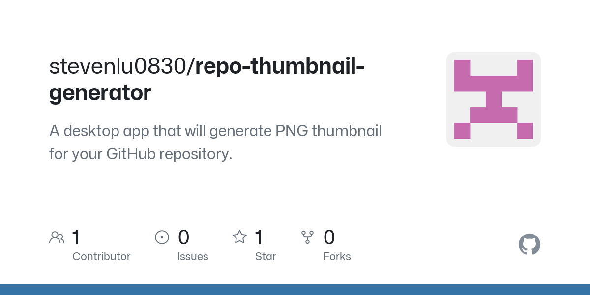
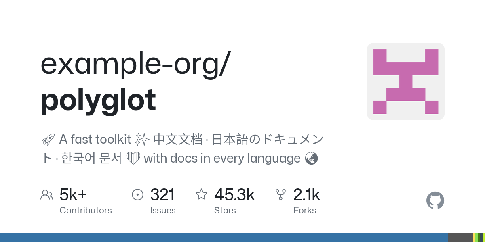

# repo-thumbnail-generator

[](https://github.com/stevenlu0830/repo-thumbnail-generator/actions/workflows/tests.yml)

Generate a GitHub-style social preview image (a 1200×600 PNG) for any GitHub repository, from its link.

**Try it online: https://github-repo-thumbnail-generator.vercel.app**



Like GitHub's own link previews, it shows:

- the `owner/repo` title, with the repo name in bold, shrinking and wrapping for long names
- the owner's avatar (a user or an organisation)
- the description, including emoji and Chinese, Japanese and Korean text
- contributors, open issues (not counting pull requests), stars and forks, shortened like `45.3k`
- a language bar in GitHub's language colours, and the GitHub logo



## Setup

Needs Python 3.11 or newer.

```bash
python3 -m venv .venv
source .venv/bin/activate
pip install -r requirements.txt
```

## Usage

```bash
python -m thumbgen
```

It asks for a repository link, then saves the thumbnail as `output/{owner}_{repo}.png`:

```
$ python -m thumbgen
Enter GitHub repo link: https://github.com/JetBrains/thinkrail
Fetching JetBrains/thinkrail ...
Saved output/JetBrains_thinkrail.png
```

You can also pass the link as an argument, which is handy in scripts:

```bash
python -m thumbgen github.com/pallets/flask
```

Any common form of link works: `https://github.com/owner/repo`, `github.com/owner/repo`, links to a branch or file (`…/tree/main/src`), `git@github.com:owner/repo.git`, or just `owner/repo`.

If something goes wrong, it stops with a one-line message instead of a traceback. For example:

```
$ python -m thumbgen stevenlu0830/no-such-repo
Fetching stevenlu0830/no-such-repo ...
Error: Repository not found. Check the link; a private repository also needs a GITHUB_TOKEN that can read it.
```

### Web app

Start the local web server:

```bash
flask run --port 5001
```

Then open http://127.0.0.1:5001, paste a repository link and press **Generate Thumbnail**. (Flask's default port, 5000, is taken on macOS by AirPlay Receiver.) The server reads `GITHUB_TOKEN` the same way the command does.

The ⓘ button in the top-right corner opens an About window with a short introduction, the tech stack and contact links. The contact links are placeholders until you fill them in, in [`public/index.html`](public/index.html).

The page shows the thumbnail with a **Download PNG** button. To share a thumbnail, copy the address bar: it changes to `/?repo=owner/repo`, and opening that address fills in the box and makes the same thumbnail.

The page uses two addresses, which you can also open directly:

| Address | Returns |
|---|---|
| `/api/thumbnail?repo=<link>` | A redirect to the repo's thumbnail address. Takes any link form the command accepts |
| `/api/thumbnail/<owner>/<repo>.png` | The thumbnail PNG. Each repo has one lowercase address, and other spellings redirect to it |

When something goes wrong, they answer with a JSON message such as `{"error": "Couldn't reach GitHub. …"}`, and the status code says what kind of problem it was:

| Status | Meaning |
|---|---|
| 400 | Not a GitHub repository link |
| 404 | No public repository at that address |
| 429 | GitHub's rate limit was reached |
| 502 | GitHub couldn't be reached |
| 500 | Any other GitHub problem, such as an expired token. The details go to the server's log, not to the visitor |

Thumbnails are sent with headers that let a CDN keep them for an hour. Errors, and thumbnails drawn with a placeholder avatar, are never kept.

## GitHub token (optional)

Without a token, GitHub allows 60 API requests an hour from your IP address, and each thumbnail uses 4. A token raises that to 5,000 an hour and lets the tool read private repositories.

1. Create a [fine-grained personal access token](https://github.com/settings/personal-access-tokens/new).
   - For public repositories, choose **Public repositories (read-only)**. No other permissions are needed.
   - For private repositories, select them and give read-only access to **Contents**, **Metadata** and **Pull requests**.
2. Set it in your terminal before running the tool:

   ```bash
   export GITHUB_TOKEN=your-token-here
   ```

   This lasts until you close the terminal. Never put the token in a file you commit.

The token is only sent to `api.github.com`.

## Deploying to Vercel

The web app runs on [Vercel](https://vercel.com)'s free Hobby plan, which is for personal, non-commercial use. Vercel runs `app.py` as a Python function and serves `public/` from its CDN.

One-time setup:

1. Create a second fine-grained token for the site, as above, with **Public repositories** access and an expiry date. Note the date: once it expires, thumbnails fail with "Something went wrong on our side", and the site's log says GitHub rejected the token.
2. In the Vercel dashboard, add a new project and import this repository from GitHub. Vercel detects Flask from `requirements.txt`, so the default settings work.
3. Before deploying, add an environment variable named `GITHUB_TOKEN`, holding the token, as a **Secret** for **Production** and **Preview**.
4. Deploy. The site is at `https://<project-name>.vercel.app`.
5. Add a firewall rule, so one visitor can't use up the token's 5,000 GitHub requests an hour. In the project, open **Firewall**, choose **Configure**, then **New Rule**:
   - **If** Request Path starts with `/api/thumbnail`
   - **Then** Rate Limit: Fixed Window, **10 minutes**, **40 requests**, counted per **IP**, answered with the default **429**
   - Save the rule, then choose **Review Changes** and **Publish**.

   Each thumbnail takes 2 requests (checking the link, then the image), so this allows 20 thumbnails per visitor every 10 minutes. The page tells a visitor who hits the limit to wait a few minutes. The Hobby plan allows one rate-limit rule per project.

After that, every push to `main` deploys to that address, and every other branch or pull request gets its own preview address. A changed environment variable, such as a new token, only applies to the next deployment, so redeploy after changing one.

The Hobby plan never charges you. If the site goes over a free limit, such as a million function calls a month, Vercel pauses it until 30 days have passed instead of billing.

**Link previews.** `public/index.html` tells sites like Slack, X and LinkedIn what to show when someone shares the site's link: its title, and the site's own thumbnail of this repo as the picture. These tags need full addresses, so they name `https://github-repo-thumbnail-generator.vercel.app`. If the site moves to another address, for example if you add your own domain under the project's **Settings → Domains**, change `og:url` and `og:image` there.

Two files configure it:

- `.python-version` picks Python 3.13, the version the tests run on.
- `vercel.json` leaves `tests/`, `scripts/` and `output/` out of the deployed function. Don't add `assets/` to that list, as Vercel's own example does: the fonts and icons are needed to draw thumbnails.

## How it works

```
repo link ──url_parser──▶ (owner, repo) ──github_api──▶ RepoInfo ──renderer──▶ PNG
```

1. [`url_parser.py`](thumbgen/url_parser.py) turns the link into an owner and repo name.
2. [`github_api.py`](thumbgen/github_api.py) makes 4 requests to the GitHub REST API, plus one avatar download:

   | Data | Endpoint |
   |---|---|
   | Description, stars, forks, open issues, avatar URL | `GET /repos/{owner}/{repo}` |
   | Bytes of code per language | `GET /repos/{owner}/{repo}/languages` |
   | Number of contributors | `GET /repos/{owner}/{repo}/contributors?per_page=1`, reading the last page number from the `Link` header |
   | Number of open pull requests, subtracted from open issues | `GET /repos/{owner}/{repo}/pulls?state=open&per_page=1`, the same way |

   It collects everything in a [`RepoInfo`](thumbgen/models.py).
3. [`renderer.py`](thumbgen/renderer.py) draws the image with Pillow. Every size, colour and position is in [`layout.py`](thumbgen/layout.py). They were measured from GitHub's own previews.

## Limitations

- **Emoji are monochrome**, in the description's grey. Combined emoji (like 👨‍👩‍👧) show as separate emoji, and `:shortcode:` emoji show as text.
- **Very large repos** like `torvalds/linux`: GitHub's API won't count their contributors, so the thumbnail shows `5k+`.
- **The font is a close match, not exact.** Mona Sans is slightly narrower than the font in GitHub's previews.
- **GitHub's own previews are cached**, so they can show older data (such as the language bar) than this tool, which always uses current data.

## Development

### Tests

The tests need a few extra packages, listed in `requirements-dev.txt`:

```bash
pip install -r requirements-dev.txt
pytest
```

The tests never call GitHub: the API tests use a fake session, and the CLI, service and web tests replace the API call.

GitHub Actions runs them on every pull request and every push to `main` ([`.github/workflows/tests.yml`](.github/workflows/tests.yml)), and the badge at the top shows the latest result. If a snapshot test fails there, the run keeps the new image and its diff as a download named `snapshot-failures`.

| File | Covers |
|---|---|
| `test_url_parser.py` | Every accepted link form, and rejecting non-repo links |
| `test_github_api.py` | Counting via `Link` headers, issues minus pull requests, error messages (not found, rate limit, bad token, no network), huge repos |
| `test_text.py` | Number formatting (`1.2k`), Star/Stars, word and CJK wrapping, "…" truncation, title wrapping |
| `test_fonts.py` | Which font draws each character (Mona Sans, emoji, CJK) |
| `test_renderer.py` | Language bar widths and colours, avatar placeholder, title sizing |
| `test_service.py` | Making a thumbnail as PNG bytes: file name, avatar placeholder, errors |
| `test_main.py` | The command line: prompt or argument, saving, error messages |
| `test_web.py` | The web app: the page, its files and link-preview picture, link redirects, PNG and cache headers, error statuses and messages |
| `test_assets.py` | The bundled fonts, icons and colours load |
| `test_snapshots.py` | Whole thumbnails, compared with reference images |

### Snapshot tests

`test_snapshots.py` draws each sample in [`tests/samples.py`](tests/samples.py) and compares it with the reference image in [`tests/snapshots/`](tests/snapshots/). Any visible change fails the test. The test then saves the new image and a diff (changed pixels in red) to `output/snapshot-failures/`.

When a change is intended, regenerate the references, look at them, and commit them with your change:

```bash
UPDATE_SNAPSHOTS=1 pytest tests/test_snapshots.py
```

### Changing the layout

1. Edit the values in [`layout.py`](thumbgen/layout.py).
2. Draw the samples without calling GitHub, and look at them in `output/`:

   ```bash
   python -m scripts.render_samples
   ```

3. When you're happy with them, update the snapshots as above.

### Rebuilding the assets

Fonts, icons and language colours are downloaded from pinned versions and committed, so the app needs nothing else to run. To refresh them, see [`scripts/build_assets.py`](scripts/build_assets.py) and [`assets/README.md`](assets/README.md).

## Project layout

```
app.py               # web app (Flask): the page, and the thumbnail API
vercel.json          # Vercel settings: which files the deployed app leaves out
.python-version      # the Python version Vercel and the GitHub Actions tests use
LICENSE              # MIT licence for the code (assets/ has its own)
.github/workflows/
  tests.yml          # runs pytest on every pull request and push to main
public/              # the page, as plain files with no build step
  index.html         # structure
  style.css          # look, including dark mode and the phone layout
  script.js          # behaviour: asks the API, then shows the image, download button or error
thumbgen/
  __main__.py        # command line: ask for the link → fetch → render → save
  service.py         # fetch → render → PNG bytes, shared by the command line and the web app
  url_parser.py      # turns a link into (owner, repo)
  github_api.py      # GitHub REST calls → RepoInfo
  models.py          # the RepoInfo dataclass
  renderer.py        # Pillow drawing
  layout.py          # sizes, colours, positions, asset paths
  text.py            # wrapping, truncation, number formatting
  fonts.py           # font loading, with CJK and emoji fallbacks
assets/              # fonts, icons, language colours (sources and licences in assets/README.md)
scripts/
  build_assets.py    # re-downloads and regenerates assets/
  render_samples.py  # draws the samples into output/
tests/
  samples.py         # hard-coded RepoInfo samples
  snapshots/         # reference images for the snapshot tests
  fixtures/          # saved avatars, so tests and samples run offline
```

## Credits

Fonts: [Mona Sans](https://github.com/github/mona-sans), [Noto Sans CJK](https://github.com/notofonts/noto-cjk) and [Noto Emoji](https://github.com/googlefonts/noto-emoji) (SIL Open Font License). Icons: [Octicons](https://github.com/primer/octicons) (MIT). Language colours: [Linguist](https://github.com/github-linguist/linguist) (MIT). Details are in [`assets/README.md`](assets/README.md).

This project is not affiliated with or endorsed by GitHub. GitHub and the GitHub logo are trademarks of GitHub, Inc.

## Licence

The code is released under the [MIT Licence](LICENSE). The fonts, icons and language colours in `assets/` keep their own licences, listed in [`assets/README.md`](assets/README.md).
